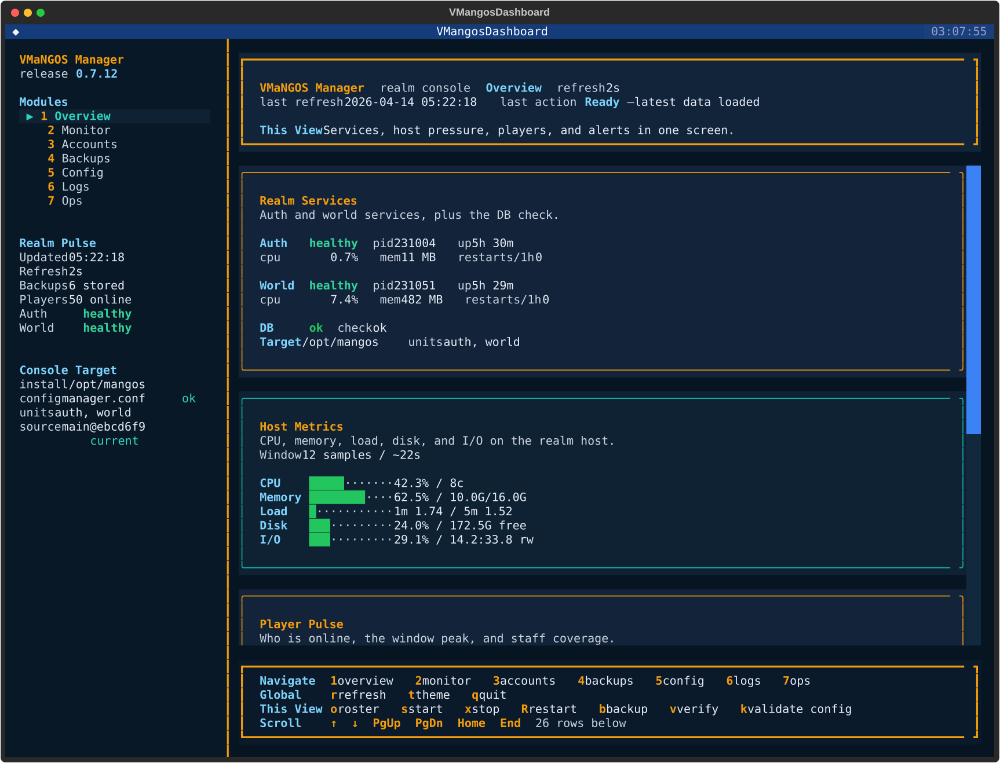
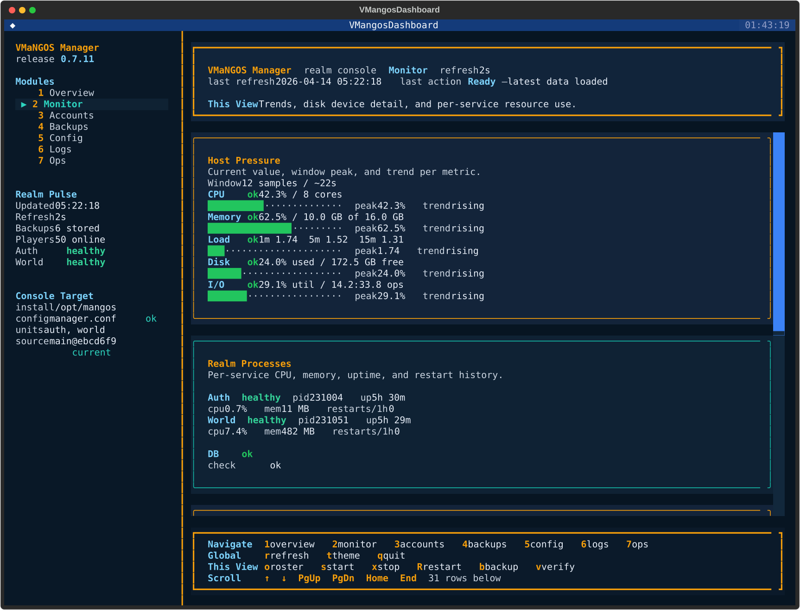
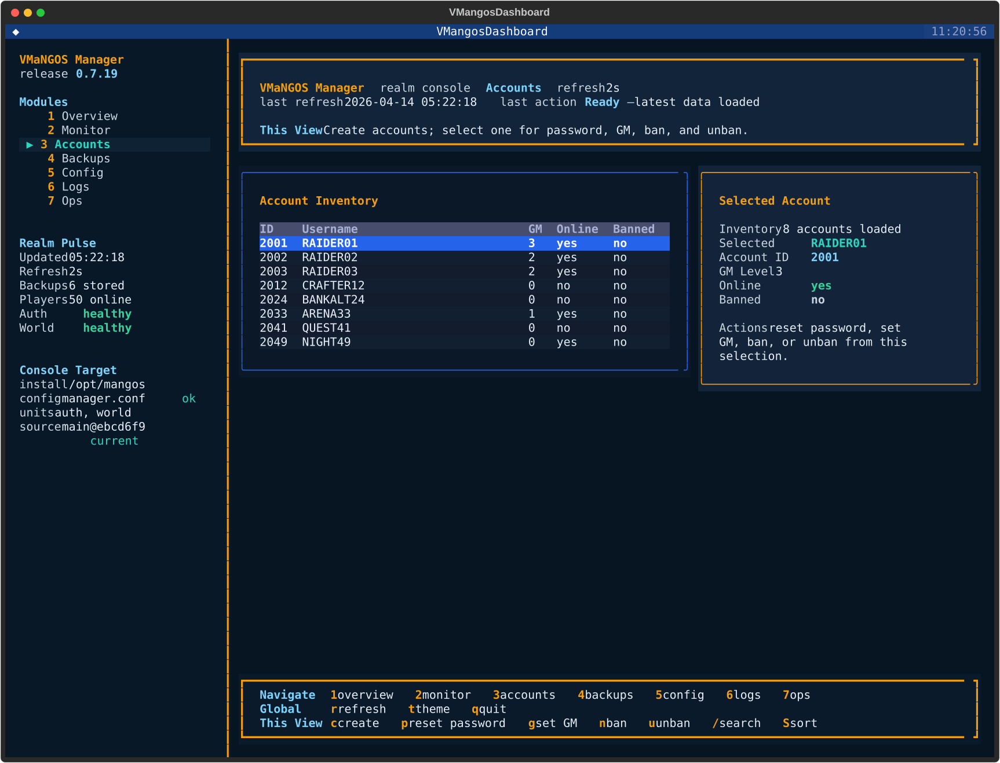
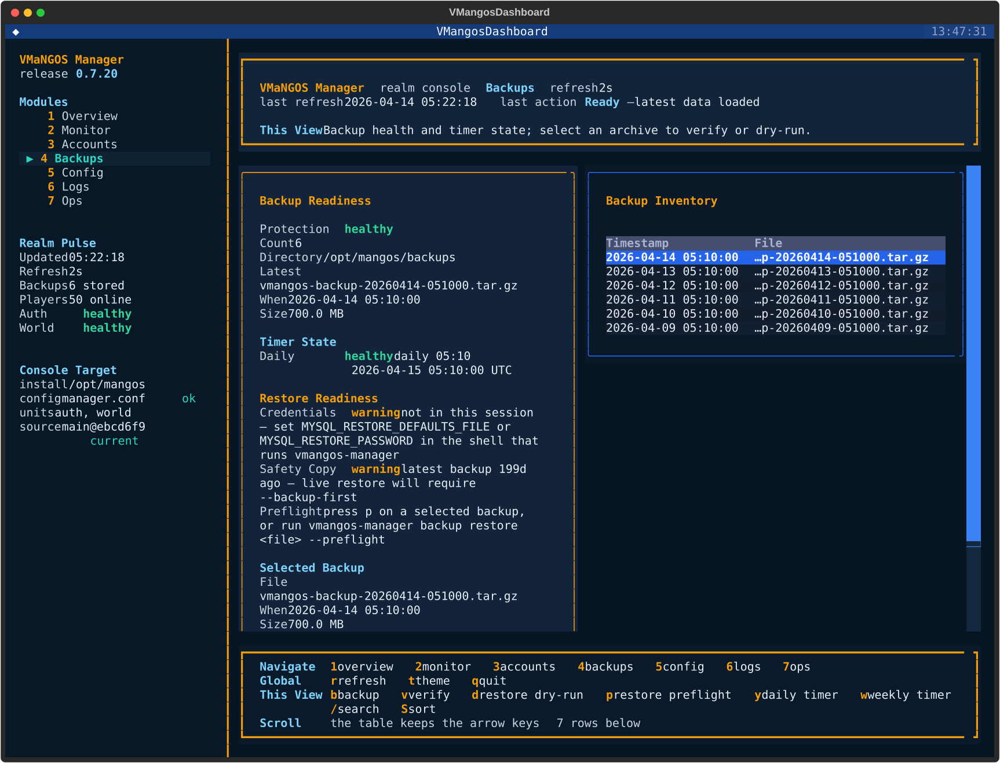
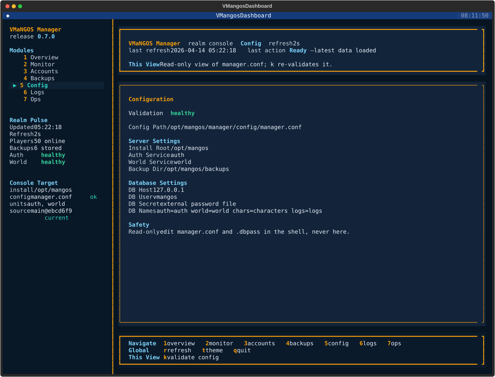
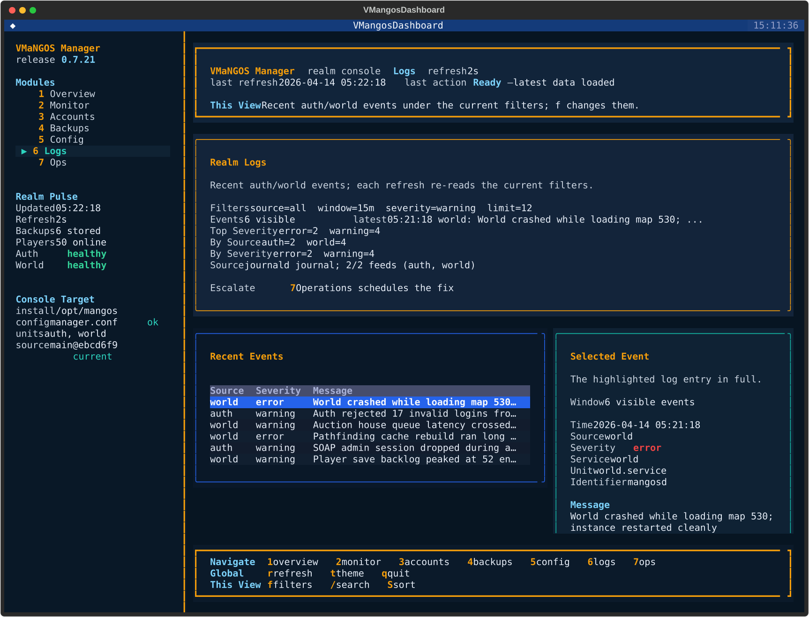
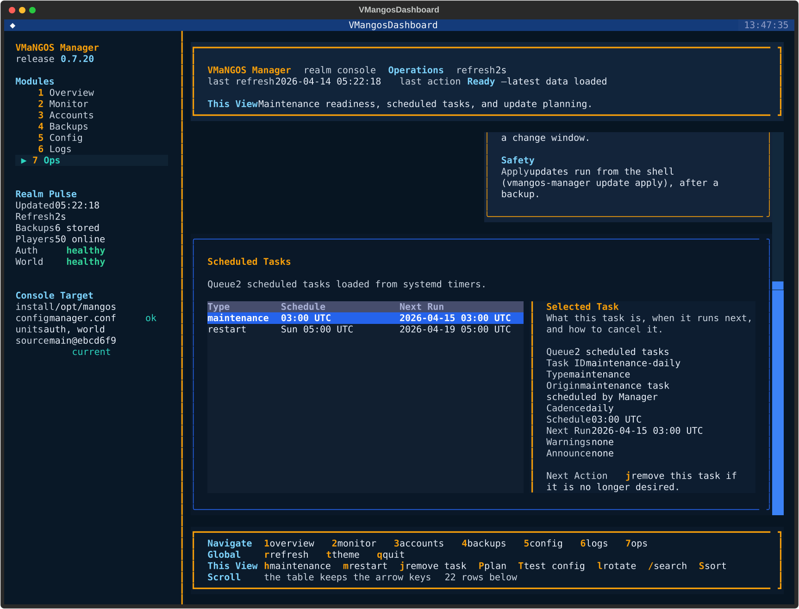

# User Guide

Welcome to **VMANGOS Manager** — the terminal-native control center for your private Vanilla WoW realm. This guide will get you from installation to confident daily operation, with a full screenshot tour of every dashboard view.

---

## 🏰 What You're Installing

VMANGOS Manager is an **operator layer** that sits on top of your existing (or new) VMANGOS server. It does not replace the core — it gives you the tools to run it day-to-day without scattering commands across shell history and handwritten notes.

**What you get:**

- **One installer** that can provision a fresh Ubuntu host from zero to running realm
- **One CLI** (`vmangos-manager`) that handles server control, accounts, backups, logs, scheduling, and updates
- **One dashboard** — a live Textual TUI you run over SSH — that visualizes the same CLI data in real time

---

## 🚀 Installation Paths

### Path A — Fresh Ubuntu 22.04 Host: the Install Wizard (recommended)

If you are starting from scratch, the wizard handles dependencies, source compilation, database creation, config generation, client data staging, and Manager provisioning — with you answering a few forms instead of editing variables.

```bash
git clone https://github.com/tonymontoya/VMaNGOS-Manager.git
cd VMaNGOS-Manager
sudo ./manager/bin/vmangos-manager install --bootstrap   # one-time (Textual deps)
sudo ./manager/bin/vmangos-manager install               # the wizard
```

**What the form asks:** install root, client data path (your WoW 1.12.1 build-5875 `Data` folder), the four database names, the DB user and password, the OS user the realm will run as, and the provision target (realm only, or realm + manager). Defaults are pre-filled; a password you leave at its generated value is crypto-random and only uses characters the server config files can carry.

A **review screen** shows every choice before anything touches the disk. Confirm, and the install launches.

**Closing the TUI never stops the install.** The install runs as its own transient systemd unit, not as a child of your terminal — close the window, drop the SSH session, nothing happens to it. To watch it again, just re-run `sudo vmangos-manager install`; the live viewer re-attaches and shows the phase checklist (prerequisites, database, source, build, extraction, import, services). Detach with `q` at any time.

**If a phase fails**, the Failure screen names the phase, the error, and the fix hint. **Retry** restarts from the last completed phase checkpoint — completed phases never re-run (a crashed build resumes, an imported database is not re-imported).

**After it completes** the realm services (`auth`, `world`) are running and everything afterwards — the dashboard, account admin, backups, logs — works unprivileged after a one-time `config grant` (see [Running as a Non-Root User](#-running-as-a-non-root-user)). Root is only needed again for service control and timers.

Secrets are stored in `/root/.vmangos-secrets/setup.conf` (mode `600`); the install log lives at `/var/log/vmangos-install.log`, and the live journal is `journalctl -u vmangos-install`.

### Headless Installs (advanced)

The raw scripts remain for automation, cloud-init, or hosts where a TUI is impractical. They are not the primary path — prefer the wizard whenever you can open a terminal:

```bash
wget https://raw.githubusercontent.com/tonymontoya/VMaNGOS-Manager/main/auto_install.sh
wget https://raw.githubusercontent.com/tonymontoya/VMaNGOS-Manager/main/vmangos_setup.sh
sudo bash auto_install.sh
```

- Defaults to `VMANGOS + Manager`
- Auto-generates secure DB credentials
- Stores secrets in `/root/.vmangos-secrets/setup.conf`
- Logs everything to `/var/log/vmangos-install.log`

Or drive `vmangos_setup.sh` directly (prompts, or environment variables for full non-interactive runs):

```bash
wget https://raw.githubusercontent.com/tonymontoya/VMaNGOS-Manager/main/vmangos_setup.sh
sudo bash vmangos_setup.sh
```

For installer internals (checkpoints, environment variables, background builds), see the [Install Automation Reference](install-automation.md).

### Path B — Existing VMANGOS Host

Already have a realm running? Manager can adopt it.

```bash
git clone https://github.com/tonymontoya/VMaNGOS-Manager.git
cd VMaNGOS-Manager/manager
make test
sudo make install PREFIX=/opt/mangos/manager
sudo /opt/mangos/manager/bin/vmangos-manager config detect
sudo /opt/mangos/manager/bin/vmangos-manager dashboard --bootstrap
sudo /opt/mangos/manager/bin/vmangos-manager dashboard --refresh 2
```

The `config detect` command performs a read-only scan of your install root, `systemd` services, and `mangosd.conf` / `realmd.conf` to propose a working `manager.conf` without overwriting anything.

### Path C — Manager Only, Realm Later

No realm yet? Install Manager first and let it describe the host as it actually is.
The same steps work on any supported LTS (22.04, 24.04, 26.04); the dashboard
environment just needs `python3-venv`:

```bash
git clone https://github.com/tonymontoya/VMaNGOS-Manager.git
cd VMaNGOS-Manager/manager
make test
sudo make install PREFIX=/opt/mangos/manager
sudo /opt/mangos/manager/bin/vmangos-manager --version          # proves what you just installed
sudo /opt/mangos/manager/bin/vmangos-manager dashboard --bootstrap
sudo /opt/mangos/manager/bin/vmangos-manager dashboard --refresh 2
```

`config detect` finds nothing to adopt and the dashboard shows empty states rather
than pretending — when you later run the wizard on that host, Manager is already
present and the wizard's `--bootstrap` step is a no-op.

---

## 🖥️ The Dashboard

The dashboard is a **Textual TUI** that runs directly on your server. Everything it displays comes from the same `vmangos-manager` CLI commands you can run in the shell, so the data is always honest.

### Launch

```bash
# One-time setup (creates Python venv and installs Textual)
sudo /opt/mangos/manager/bin/vmangos-manager dashboard --bootstrap

# Run the dashboard with a 2-second refresh interval
sudo /opt/mangos/manager/bin/vmangos-manager dashboard --refresh 2
```

### Navigation

| Key | View | What You Do There |
|:---:|:---|:---|
| `1` | **Overview** | Quick health check: services, CPU, memory, players, alerts |
| `2` | **Monitor** | Deep-dive host pressure: trends, disk I/O, process footprint |
| `3` | **Accounts** | Create accounts, reset passwords, set GM level, ban/unban |
| `4` | **Backups** | Check archive inventory, verify integrity, dry-run and preflight restores |
| `5` | **Config** | Validate how Manager reads your install paths and DB wiring |
| `6` | **Logs** | Investigate recent `auth`/`world` events with filters |
| `7` | **Operations** | Schedule maintenance, review queued tasks, plan updates |

The number keys are the fast path, but not the only one: you can click a module row in the left sidebar, or press `ctrl+p` to open the command palette and search for a view or action by name. Action outcomes (successes and failures) also surface as toast notifications in the corner, and the auto-refresh pauses whenever a dialog is open so tables don't shift under you.

---

## 📸 Dashboard Tour

### Overview — Your Realm at a Glance



This is the default view and the one you leave open. It shows:

- `auth` and `world` service health, uptime, and process footprint
- Headline CPU, memory, load, and disk usage
- Player count, GM presence, and active alerts

**Common actions:** `s` start, `x` stop, `R` restart, `b` backup, `v` verify, `k` validate config.

If something looks off here, press `2` to jump into **Monitor** for the diagnosis.

---

### Monitor — Diagnose Pressure



**Monitor** exists so **Overview** can stay readable. Use this view when you need to understand *why* the host is under pressure.

**Panels:**
- **Pressure Deck** — current capacity bars for CPU, memory, load, and disk
- **Realm Process Footprint** — `auth` and `world` memory/CPU usage side by side
- **Trend Ledger** — recent peak values and sparkline history
- **Storage and Device** — disk saturation and `iostat` context

> **Tip:** Resize your terminal taller before camping on this view. The extra vertical space makes the trend and storage panels much easier to read.

---

### Accounts — Player Administration



Select an account row, then act on it from the command rail.

**Actions:**
- `c` — create account
- `p` — reset password
- `g` — set GM level (0–3)
- `n` — ban
- `u` — unban

The right-hand pane shows the selected account's details, so you can confirm state changes immediately after an action completes.

---

### Backups — Protection You Can Inspect



Backups are only useful if you can verify them. This view shows:

- Complete backup inventory with timestamps and sizes
- One-press verify for the selected archive
- Restore dry-run to preview recovery steps
- Restore readiness at a glance: whether this session holds privileged restore credentials, and whether the current databases have a backup inside the 24-hour safety window
- Daily and weekly timer creation

**Habit before risky work:**
1. Press `b` to create a backup now
2. Press `v` to verify it
3. Press `d` to dry-run a restore
4. Press `p` to run the full restore preflight (integrity, credentials, auth probe, safety backup)

> **Note:** Live restore execution, cleanup policies, and timer removal are handled in the CLI. See [Recovery Runbook](#-recovery-runbook) for the guarded workflow.

---

### Config — Confidence in Your Wiring



**Config** is intentionally read-only. It tells you exactly how Manager understands the host, so you can spot mismatches before they break automation.

**Check here for:**
- Install root and service names
- Database host, port, and DB names
- Backup directory wiring
- How credentials are sourced (without exposing them in plaintext)

If something looks wrong, edit `manager.conf` or `.dbpass` in the shell, then return here and press `k` to re-validate.

---

### Logs — Realm Troubleshooting



**Logs** queries `journald` for recent `auth` and `world` activity. You can filter by source, time window, severity, and result limit — all without leaving Manager.

**How to investigate an incident:**
1. Press `6` to open Logs
2. Press `f` to set your filters
3. Watch the feed auto-refresh while you inspect selected events in the detail pane

This keeps troubleshooting scoped to realm-relevant evidence instead of becoming a generic OS log browser.

---

### Operations — Maintenance & Change Windows



**Operations** is where you plan and schedule maintenance work.

**Panels:**
- **Maintenance Readiness** — storage headroom, log-rotation posture, queue health
- **Scheduled Tasks** — what is queued and when it fires
- **Selected Task** — origin, cadence, warnings, and cancellation impact
- **Change Window Readiness** — DB impact summary before source updates

**Before any realm update:**
1. Review Maintenance Readiness
2. Review Scheduled Tasks for conflicts
3. Check Change Window Readiness
4. Take and verify a backup
5. Run the actual update from the CLI during your approved window

---

## ✅ Your First 5 Minutes

After install, run through this checklist once:

```bash
# 1. Validate configuration
sudo /opt/mangos/manager/bin/vmangos-manager config validate

# 2. Bootstrap the dashboard environment
sudo /opt/mangos/manager/bin/vmangos-manager dashboard --bootstrap

# 3. Launch the dashboard and confirm services look healthy
sudo /opt/mangos/manager/bin/vmangos-manager dashboard --refresh 2

# 4. Check backup posture
sudo /opt/mangos/manager/bin/vmangos-manager backup list

# 5. Review recent logs
sudo /opt/mangos/manager/bin/vmangos-manager logs recent --limit 10
```

---

## 🔥 Everyday CLI Cheat Sheet

| Task | Command |
|---|---|
| Install or re-attach to an install | `sudo vmangos-manager install` |
| Open the dashboard | `vmangos-manager` (no arguments needed) |
| Watch live status | `vmangos-manager server status --watch` |
| Create account | `VMANGOS_PASSWORD='pass' vmangos-manager account create USER --password-env` |
| Set GM level | `vmangos-manager account setgm USER 3` |
| Ban account | `vmangos-manager account ban USER 7d --reason "Rule violation"` |
| Backup now + verify | `vmangos-manager backup now --verify` |
| Check recent errors | `vmangos-manager logs recent --source world --severity error` |
| Check for updates | `vmangos-manager update check` |
| Inspect DB impact | `vmangos-manager update inspect` |
| Start services and wait for health | `sudo vmangos-manager server start --wait` |
| Restart services | `sudo vmangos-manager server restart` |
| Schedule daily backup | `sudo vmangos-manager backup schedule --daily 04:00` |
| Schedule weekly restart | `sudo vmangos-manager schedule restart --time 04:00 --weekly Sun` |

Commands marked `sudo` touch systemd (services or timers) and stay root-only. Everything else works as your normal user once access is granted (see [Running as a Non-Root User](#-running-as-a-non-root-user)).

---

## 🗓️ Maintenance Rhythm

### Daily
- [ ] Open **Overview** and confirm services, players, and host pressure look normal
- [ ] Check **Backups** if you are about to do risky work
- [ ] Handle any account admin in **Accounts**

### Weekly
- [ ] Review **Monitor** for trend anomalies
- [ ] Verify the most recent backup (`v` in Backups)
- [ ] Review **Operations** for queued maintenance windows
- [ ] Check **Logs** for repeated `auth`/`world` errors

### Before Updates
- [ ] Review **Operations** → Maintenance Readiness + Scheduled Tasks
- [ ] Run `update inspect` to check DB impact
- [ ] Create and verify a backup
- [ ] Run the update inside an approved maintenance window

---

## 🔑 Running as a Non-Root User

The installer provisions everything under the `mangos` service account, including the manager config (which contains the path to the database password file). By default only `root` and `mangos` can read it, so a plain user gets `Configuration file is not readable` on every command.

Grant yourself access once, as root:

```bash
sudo /opt/mangos/manager/bin/vmangos-manager config grant --user <your-username>
```

Then **log out and back in** — the group membership it adds only applies to new sessions. Afterwards `vmangos-manager`, the dashboard, account admin, logs, and backups all work without sudo.

Still requires root (run via sudo): starting/stopping/restarting the realm services, installing backup/maintenance systemd timers, and log rotation changes.

---

## 🖥️ vs ⌨️ Dashboard vs CLI

Use the dashboard for day-to-day operation. Drop to the CLI for scripting, raw JSON, bulk workflows, or advanced paths.

| Area | Dashboard | CLI |
|---|---|---|
| **Server** | Summary status, start/stop/restart | Watch mode, raw JSON |
| **Monitor** | Trends, process footprint, disk I/O | Ad hoc host tooling |
| **Accounts** | Inventory, create, password reset, GM, ban/unban | Scripted bulk workflows |
| **Backups** | Inventory, create, verify, dry-run, preflight, readiness, timer visibility | Cleanup, timer removal, live restore |
| **Config** | Read-only wiring validation | Detect, create, show, file editing |
| **Logs** | Filtered investigation, live refresh | Raw JSON, watch mode, shell pipelines |
| **Operations** | Maintenance readiness, task queue, planning | Update apply, source-tree work |

---

## 🔄 Updates Workflow

Manager treats updates as a deliberate workflow, not a blind pull.

```bash
# 1. Check what is available
sudo /opt/mangos/manager/bin/vmangos-manager update check

# 2. Inspect DB impact (read-only)
sudo /opt/mangos/manager/bin/vmangos-manager update inspect

# 3. Generate a plan
sudo /opt/mangos/manager/bin/vmangos-manager update plan --include-db

# 4. Apply during a maintenance window
sudo /opt/mangos/manager/bin/vmangos-manager update apply --backup-first --include-db
```

> **Safety notes from the code:**
> - `update apply` is **non-atomic** and does not promise rollback.
> - It **rejects dirty or divergent** source trees.
> - It **fails closed** on unsupported SQL changes outside `sql/migrations`.

---

## 🚑 Recovery Runbook

Live restore is a CLI-only, deliberately high-friction workflow. Nothing destructive runs until every preflight check passes **and** you confirm. Budget a maintenance window; users will be disconnected.

### Preconditions

1. **A verified backup** — the archive you intend to restore (`backup verify <file>` passes).
2. **Privileged DB credentials** — restore never uses the limited manager DB user. In the recovery shell export:
   ```bash
   export MYSQL_RESTORE_PASSWORD='root-password'     # or point at a mode-600 defaults file:
   # export MYSQL_RESTORE_DEFAULTS_FILE=/root/.mysql-restore.cnf
   ```
3. **A fresh snapshot of current state** — restore refuses to overwrite the databases unless the newest backup is under 24 hours old, so you always have an undo point. No recent backup? `--backup-first` takes one for you.

### Steps

```bash
# 1. Preview the plan (no checks with side effects, nothing changes)
sudo /opt/mangos/manager/bin/vmangos-manager backup restore <file> --dry-run

# 2. Run the full preflight: integrity, credentials, live auth probe, safety backup
sudo /opt/mangos/manager/bin/vmangos-manager backup restore <file> --preflight

# 3. Execute during the approved window.
#    Interactive: you will be asked to type RESTORE.
sudo /opt/mangos/manager/bin/vmangos-manager backup restore <file> --backup-first

#    Scripted: --yes is the only non-interactive confirmation path
sudo /opt/mangos/manager/bin/vmangos-manager backup restore <file> --yes --backup-first
```

### What the command does, in order

1. Preflight (fail closed: credentials, auth probe, safety backup — **before** anything stops)
2. Typed `RESTORE` confirmation (or `--yes`)
3. Optional `--backup-first` snapshot of current databases
4. Stop world, stop auth
5. Import the dump with the privileged credentials
6. Start auth and world, then verify both services are active and the DB answers

### After the restore

- The command itself validates services and DB connectivity and prints next steps.
- Spot-check a known account or character in-game or via `account list`.
- If anything looks wrong, the `--backup-first` archive of the *previous* state is your undo path — run this same runbook against it.

### If it fails

- `RESTORE_PARTIAL` — the import failed or services did not come back. Manager restarts services when it can; check `systemctl status` for the auth/world units and see [Troubleshooting](troubleshooting.md).
- Preflight refusal — nothing was changed; fix the reported check and rerun.

The dashboard's Backups view mirrors this contract read-only: **Restore Readiness** shows whether the session holds credentials and whether the safety window is satisfied, and `p` runs the same preflight against the selected backup.

---

## 📖 Next Steps

- **[CLI Reference](cli-reference.md)** — every command, flag, and option
- **[Install Automation](install-automation.md)** — installer internals and environment variables
- **[Security Notes](security.md)** — password handling, DB access model, update safety
- **[Troubleshooting](troubleshooting.md)** — common issues and diagnostic commands

---

**Manager is strongest when it becomes the place where routine realm operations live.** Install it cleanly, validate the config early, keep the dashboard close at hand, and treat backups and update planning as first-class workflows.
